# SkillGuard v2 (`skillguard/2`)

[English](README.md) | [简体中文](README.zh-CN.md)

**Commit-Pinned MCP & Agent Skill Supply-Chain Attestation Registry on GenLayer (`skillguard/2` with Contract-Enforced Complete Release Tree Commitment + Omitted-Evidence Challenge Path)**

> **Live Demo (GitHub Pages)**: [https://glieser2.github.io/skillguard/](https://glieser2.github.io/skillguard/)  
> **GitHub Repository**: [https://github.com/glieser2/skillguard](https://github.com/glieser2/skillguard)  
> **GenLayer Testnet Bradbury Phase 2 (`chainId = 4221`)**: [`0x6AA5b430483d7DfBae3CBEc4e578160DE9504612`](https://scan.bradbury.genlayer.com/address/0x6AA5b430483d7DfBae3CBEc4e578160DE9504612)

---

## What Changed in SkillGuard v2 (`skillguard/2`)

In response to Steward review feedback on v1 (*"publishers can omit executable files and dependencies while still receiving an approved pre-install result. A future submission would need a contract-enforced complete release manifest or tree commitment and a challenge path that can add omitted evidence"*), **SkillGuard v2 (`skillguard/2`)** introduces three contract-enforced security guarantees:

1. **Contract-Enforced Complete Release `tree_commitment` & Anti-Evasion Classification (`register_release`)**:
   - Every release submission must include a complete `tree_commitment` (`tree_sha256`, `total_files`, `declared_dependencies`, and `tree_entries`).
   - The contract enforces an anti-evasion file classification rule (`validate_tree_commitment`):
     - All executable extensions (`.py`, `.js`, `.mjs`, `.cjs`, `.ts`, `.tsx`, `.jsx`, `.sh`, `.bash`, `.ps1`, `.sol`, `.rs`, `.go`, `.rb`, `.php`, `.wasm`, `.bin`) **must** be classified as `role = "executable"` (cannot be disguised as `"asset"` or `"doc"`).
     - All manifest files (`package.json`, `pyproject.toml`, `requirements.txt`, `cargo.toml`, `skill.json`, `mcp.json`, `manifest.json`) **must** be classified as `role = "manifest"`.
     - **100% of `"manifest"` and `"executable"` entries** in `tree_entries` must be included in the audited `sources` list, with exact path, role, and `sha256` alignment.
2. **Deterministic Manifest Install-Hook & Dependency Screening (`lock_evidence`)**:
   - During `lock_evidence(release_id)`, validators deterministically fetch raw commit-pinned bytes via `gl.eq_principle.strict_eq`, verify SHA-256 hashes, and parse manifest files (`package.json` / `skill.json` / `mcp.json`):
     - Any lifecycle execution hook (`preinstall`, `install`, `postinstall`, `prepare`, `prepublishOnly`) triggers `MANIFEST_INSTALL_HOOK`.
     - Any dependency in `dependencies` / `optionalDependencies` / `peerDependencies` missing from `tree_commitment.declared_dependencies`, or pinned to mutable versions (`*`, `latest`, `git+`, `http://`, `https://`, `file:`, `link:`), triggers `UNDECLARED_OR_UNPINNED_DEPENDENCY` (`OMITTED_EXECUTABLE_OR_DEPENDENCY`), immediately forcing `CRITICAL` / `BLOCKED`.
3. **Omitted-Evidence Challenge Path (`challenge_release` -> `lock_challenge_evidence` -> `audit_release`)**:
   - If a publisher omits an executable or manifest file that exists in the upstream Git commit from `tree_commitment`, any challenger can call `challenge_release(release_id, reason, evidence, omitted_sources)` supplying the omitted file descriptors (`path`, `raw_url`, `sha256`, `role`) pinned to the exact same `repo@commit_sha`.
   - Calling `lock_challenge_evidence(release_id, challenge_id)` fetches those omitted files on-chain via GenLayer validator consensus (`strict_eq`), verifies their SHA-256 hashes, appends them to the release's `extra_sources` and `proven_omitted_paths`, and marks the challenge `evidence_locked = True`.
   - Calling `audit_release(release_id)` then deterministically escalates the release to `BLOCKED` (`CRITICAL` risk, `OMITTED_EXECUTABLE_OR_DEPENDENCY`) and marks the challenge `UPHELD`.
4. **Local Directory Tree Verification in CLI & MCP (`--dir <local_dir>`)**:
   - `npx skillguard check <owner/repo> <commit_sha> --dir <local_dir>` and the `skillguard_check_release` MCP tool verify that the local directory contains zero untracked executable/manifest files and that every local file matches the on-chain `tree_commitment` SHA-256 before execution.

---

## Why SkillGuard Needs GenLayer

1. **Verifiable Commit-Pinned Evidence Fetching (`gl.nondet.web.get` + `gl.eq_principle.strict_eq`)**  
   Before any LLM evaluates a release—or when a challenger proves an omitted file exists in the repository—validators fetch the commit-pinned GitHub Raw URL (`https://raw.githubusercontent.com/<owner>/<repo>/<40-hex-commit>/<path>`), normalize line endings, and verify the exact SHA-256 hash under `strict_eq`.
2. **Deterministic Static Guardrails + Multi-LLM Semantic Capability Consensus**  
   The contract runs a deterministic static scanner across all locked files for prompt-injection phrases (`IGNORE ALL PREVIOUS INSTRUCTIONS`, etc.), manifest install hooks, and undeclared/unpinned dependencies, then executes a structured rubric prompt (`gl.nondet.exec_prompt` under `strict_eq`) across 5 capability dimensions:
   - `network_access` (external HTTP/WebSocket requests or data exfiltration)
   - `filesystem_write` (creating, modifying, or deleting host files)
   - `subprocess_exec` (spawning shells, subprocesses, or `eval`/`exec`)
   - `env_secret_access` (reading `.env` tokens, private keys, seed phrases, or browser credentials)
   - `dynamic_skill_install` (downloading or executing remote code at runtime)
3. **Permissionless Omitted-Evidence & Prompt-Injection Challenge Loop**  
   Anyone can challenge a release with either text evidence or concrete `omitted_sources` from the same commit, lock the omitted files on-chain via `lock_challenge_evidence`, and trigger a full re-audit round (`audit_release`).

---

## Live On-Chain Deployments & Proof Artifacts

### 1. GenLayer Testnet Bradbury Phase 2 (`chainId = 4221`) — Production v2 Deployment

Recorded in [`artifacts/bradbury-deployment-proof.json`](artifacts/bradbury-deployment-proof.json) and [`src/deployment.json`](src/deployment.json):

| Field | Value |
| :--- | :--- |
| **Network** | GenLayer Testnet Bradbury Phase 2 (`https://rpc.bradbury.genlayer.com`, `chainId = 4221`) |
| **Policy Version** | `skillguard/2` (verified via on-chain `get_policy_version()`) |
| **Contract Address** | [`0x6AA5b430483d7DfBae3CBEc4e578160DE9504612`](https://scan.bradbury.genlayer.com/address/0x6AA5b430483d7DfBae3CBEc4e578160DE9504612) |
| **Deployer Address** | `0x5d89aa09Dea3aa1792B6a5E7de755A97d9c504bD` |
| **Protocol Tx ID** | `0x401dee443cff3f815efe941b5709f3bdaf2d154062be1d4f920284d247c498d7` |
| **L2 Envelope Tx Hash** | `0xf243f48f508760a116c18e2ea7452c1bbbb53e5d0cc5159620c7b3b9b5d3e1c6` |
| **Block Number** | `268801` (`0x1354c2549d452873147144df864153ac24f282d5803a5b767982ee623c0d0986`) |
| **Consensus Status** | `FINALIZED` / `MAJORITY_AGREE` (`result = 0 / FINISHED_WITH_RETURN`) |
| **Canonical Source** | [`contracts/skill_guard.py`](contracts/skill_guard.py) (`41,717` bytes, SHA-256 `39d65ba94fb04d087a050fe51f7cd2fc14ba644bc08ed85bbf8e152dc3c61570`) |
| **Compact Source** | [`contracts/skill_guard_compact.py`](contracts/skill_guard_compact.py) (`34,332` bytes, SHA-256 `6e76cc92b10ddb1f8cecf86b41096d733106ef636f06640dbba25fbef3114d10`, `ast_equivalent = true`) |

### 2. GenLayer Consensus Studio-dev (`chainId = 61997`) — Full E2E Lifecycle Proof

Recorded in [`artifacts/studio-e2e.json`](artifacts/studio-e2e.json):

- **Contract Address**: `0x1C357d261e5A048FFEdA6Ac79Ea532ebb429DEAe` (`deploymentTx = 0xe563d072307604b9f51546bb47b0dadfaf3708e78a25df03e86f76ad5b65d051`, `get_policy_version() == "skillguard/2"`)
- **Release #1 (Complete Tree Commitment -> `APPROVED` / `LOW` Risk)**:
  - Target: `OpenZeppelin/openzeppelin-contracts@3e6c86392c97fbc30d3d20a378a6f58beba08eba` (`contracts/package.json` + `contracts/utils/Context.sol` + `contracts/access/Ownable.sol`, `tree_sha256 = a707f860579e11607d94133d9f75d005eb9757f7cb4480cec4c02f170b94fda2`)
  - `register_release` Tx: `0x4dedf854d11ba1537bd42b47c3e458eb86ef60132506d9e5490b30549da66927`
  - `lock_evidence` Tx: `0xf9af5bbd791b861284e6f84a83641f649048863599a44eb54e9684214b88ba2c`
  - `audit_release` Tx: `0x4a7ef371ce394a644b7416ab728557c169e5082d9c30db0f94366ac375ec8b7f` -> **`status = "APPROVED"`, `risk_level = "LOW"`**
- **Release #2 (Omitted-Evidence Challenge Path -> `BLOCKED` / `CRITICAL` / `UPHELD`)**:
  - Target: `OpenZeppelin/openzeppelin-contracts@b7f748eae2341b9e8e8f85cf966e94476813d168` (publisher registers `contracts/package.json` + `contracts/utils/Context.sol`, omitting `contracts/access/Ownable.sol` from `tree_commitment`)
  - `register_release` Tx: `0x28ea602faf3c7a1e10a1a5acfa0a5b08469f2f98bc46373f0ff01207b09ecfa1`
  - `lock_evidence` Tx: `0xc3a35b044a756c0d9fa76c218d2105c7dbbc37f9d7ca90fd66956c7eb07efae2`
  - Round 1 `audit_release` Tx: `0x327714fb8db577049203814e0ce12bd1d364d80ff7b433b3b9783137632d6348` (`APPROVED` before challenge)
  - `challenge_release` Tx (submitting omitted `contracts/access/Ownable.sol` descriptor): `0xf89808074dbeb72e7113e30da3d636acbb644460643ed0e42f864a46a7215e3b`
  - `lock_challenge_evidence` Tx (validators fetch & hash-verify `Ownable.sol` on-chain): `0x37f4a8f710ed5a703cb10f2964b0a2c7c73915a3f1e5deac85704a7faae9966f`
  - Round 2 `audit_release` Tx: `0xde92ca72e216ef953506bd09da6da9734ae78304778c8b680db138ab590ab1ab` -> **`status = "BLOCKED"`, `risk_level = "CRITICAL"`, `violation_codes = ["OMITTED_EXECUTABLE_OR_DEPENDENCY"]`, `proven_omitted_paths = ["contracts/access/Ownable.sol"]`, `challenge #1 status = "UPHELD"`**

---

## Architecture & End-to-End Attestation Flow (`skillguard/2`)

```mermaid
flowchart LR
    subgraph Publisher["1. Release Registration + Complete Tree Commitment"]
        A["Publisher submits repo@40-hex-commit<br/>+ tree_commitment (tree_sha256, declared_dependencies, tree_entries)<br/>+ 100% of manifest & executable sources"]
        A --> B["Contract enforces anti-evasion role check<br/>& 100% manifest/executable coverage"]
    end

    subgraph Lock["2. Commit-Pinned Evidence Lock (strict_eq)"]
        B --> C["Validators fetch raw GitHub bytes<br/>Verify SHA-256 & compute snapshot_hash"]
        C --> D["Deterministic Static & Manifest Guard:<br/>Prompt-injection markers + install hooks<br/>+ undeclared/unpinned dependencies"]
    end

    subgraph Consensus["3. Multi-LLM Capability Consensus (strict_eq)"]
        D --> E["Validators run structured rubric prompt<br/>across 5 capability dimensions"]
        E --> F{"Undeclared capability,<br/>static violation, or<br/>proven omitted file?"}
        F -- "No" --> G["APPROVED / HIGH_RISK"]
        F -- "Yes" --> H["BLOCKED (CRITICAL)"]
    end

    subgraph Challenge["4. Omitted-Evidence Challenge Path"]
        G -. "Challenger submits omitted_sources<br/>from same repo@commit" .-> I["challenge_release(omitted_sources)"]
        I --> J["lock_challenge_evidence:<br/>Validators fetch & verify omitted file on-chain"]
        J --> K["audit_release:<br/>Proven omission -> BLOCKED (CRITICAL)<br/>Challenge #ID -> UPHELD"]
    end

    subgraph Client["5. Pre-Install CLI & MCP Gate"]
        G --> L["npx skillguard check --dir .<br/>Verifies on-chain status + local tree_commitment"]
        H --> L
        K --> L
    end
```



---

## Repository Structure

```text
skillguard/
├── contracts/
│   ├── skill_guard.py                 # Canonical GenLayer Intelligent Contract (skillguard/2)
│   └── skill_guard_compact.py         # AST-equivalent compact contract for Bradbury RPC
├── cli/
│   ├── skillguard.mjs                 # Pre-install CLI gate with --dir local tree verification
│   └── mcp-server.mjs                 # Stdio JSON-RPC 2.0 MCP server (skillguard_check_release)
├── scripts/
│   ├── build-compact-contract.py      # Generates & verifies AST-equivalent compact contract
│   ├── deploy-studio.mjs              # Automated Studio-dev E2E verification (Release #1 & #2)
│   └── verify-bradbury-deployment.mjs # Bradbury Phase 2 deployment proof generator
├── artifacts/
│   ├── bradbury-deployment-proof.json # Finalized Bradbury Phase 2 v2 deployment proof
│   └── studio-e2e.json                # Finalized Studio-dev v2 E2E lifecycle proof
├── src/
│   ├── lib/
│   │   ├── domain.ts                  # Isomorphic v2 contract logic & local sandbox engine
│   │   ├── live.ts                    # GenLayer genlayer-js client + EIP-6963 MetaMask integration
│   │   ├── demo.ts                    # Curated supply-chain scenarios (including v2 tree commitment)
│   │   └── i18n.ts                    # Bilingual (English default / 简体中文) UI dictionary
│   ├── App.tsx                        # Interactive workbench UI (tree commitment & omitted-file challenge)
│   └── deployment.json                # Active Bradbury Phase 2 & Studio-dev deployment config
└── tests/
    ├── python/
    │   └── test_contract_logic.py     # 10 unit tests covering v2 tree commitment & omitted-file challenges
    └── cli.test.mjs                   # Node CLI & MCP server integration tests (including --dir check)
```

---

## Quick Start & Verification Guide

### Prerequisites
- **Node.js** `>= 20` and `corepack pnpm`
- **Python** `>= 3.11` (for running the Python contract test suite)

### 1. Install Dependencies & Run All Automated Tests

```bash
corepack pnpm install

# Run Python contract logic unit tests (10/10 passing, including tree_commitment & omitted-file challenges)
python -m unittest discover -s tests/python -v

# Run Vitest domain tests + Node CLI/MCP integration tests (including --dir local tree check)
corepack pnpm test

# Build production frontend bundle
corepack pnpm build
```

### 2. Run the Pre-Install CLI Gate (with Local Directory Tree Verification)

```bash
# 1. Approved release check (exit code 0)
node cli/skillguard.mjs check OpenZeppelin/openzeppelin-contracts 3e6c86392c97fbc30d3d20a378a6f58beba08eba --demo

# 2. Verify a local directory against the release's on-chain tree_commitment
#    Flags any untracked local executable/manifest files or SHA-256 mismatches (exit code 2 on mismatch)
node cli/skillguard.mjs check OpenZeppelin/openzeppelin-contracts 3e6c86392c97fbc30d3d20a378a6f58beba08eba --demo --dir .

# 3. Blocked malicious MCP release check (exit code 2)
node cli/skillguard.mjs check agent-tools-lab/solana-rebalancer-mcp 7b4e9102c5f841d8a92b0e11c4f97a8e3d21b604 --demo
```

### 3. Run the Interactive Workbench Locally

```bash
corepack pnpm dev
```

Open `http://127.0.0.1:5173/`:
- Switch between **English** (default) and **简体中文** in the top navigation bar.
- Inspect the **Release Tree Commitment & Audited Source Files** tab to see `tree_sha256`, `declared_dependencies`, and file-by-file role coverage (`manifest`, `executable`, `doc`, `asset`).
- Click **Submit Challenge** on any release and use the **Omitted Executable / Manifest Files (`omitted_sources`)** section (including the one-click preset for `contracts/access/Ownable.sol`) to test the full `challenge_release` -> `lock_challenge_evidence` -> `audit_release` escalation flow.

---

## License

MIT
